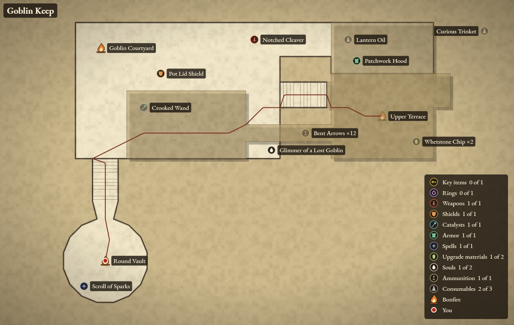
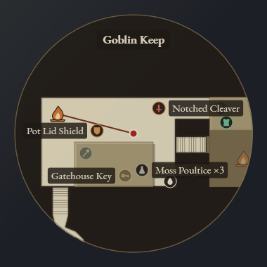
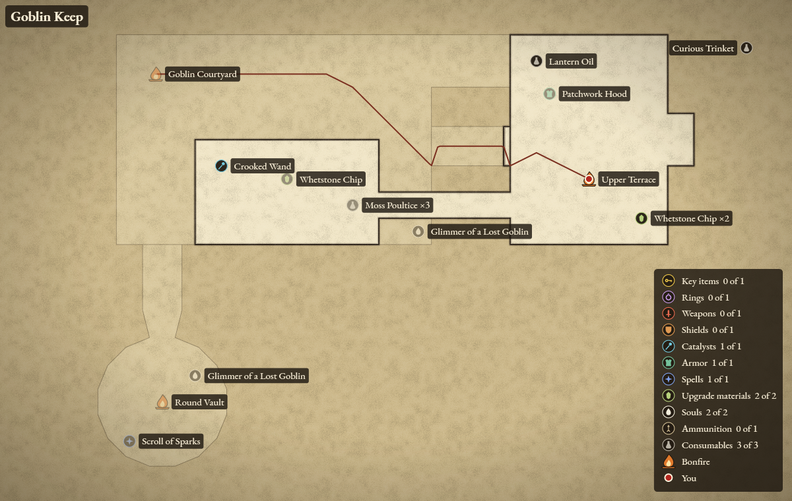

# Loot Goblins Map

**A loot map for Dark Souls III that sits over the game and shows what you have not picked up yet.**

It draws a minimap around you, with every item still lying in the area, the bonfires, and the
floor you are on. One key opens the full map of the area. Pick an item up and it disappears
from the map.

It only reads. It never changes the game, its files or its memory, and it never goes online.



*The pictures on this page show a made-up demo area that ships with the program. They are not
from the game: this repository contains no game screenshots and no game data.*

<!-- Screenshot slots. In-game screenshots are deliberately not kept in this repository.
     If you publish some elsewhere, these are the names the page was written for:
       screenshot-minimap-ingame.png   the minimap in a corner of the game
       screenshot-fullmap-ingame.png   the full map open over the game
       screenshot-settings.png         the settings window -->

## What it does

- **Minimap** in a corner of the game, centred on you, showing the floor you are on.
- **Full map** of the current area on a hotkey, with a legend and a count of what is left.
- **Every area of the game**, and both DLCs when you own them.
- **Items you have not picked up**, named, in eleven categories you can switch on and off:
  key items, rings, weapons, shields, catalysts, armor, spells, upgrade materials, souls,
  ammunition and consumables. Collected items vanish (or stay dimmed, if you prefer).
- **Layers.** Areas with several storeys are split into layers; the one you are on is drawn in
  full, the others faded. You can page through the layers on the full map.
- **Bonfires**, by name.
- **Two looks**: "parchment" (ink on aged paper) and "plain". Both are files you can edit.
- **Click-through.** The overlay never takes the mouse or the keyboard away from the game.

| Minimap | Upper layer of the same area |
| --- | --- |
|  |  |

## Install and first run

1. Download the latest zip from the [releases page](https://github.com/Buzzed-Lightyear/LootGoblinsMap-DS3/releases).
   If you like, check it against the SHA-256 listed there.
2. Unzip it anywhere **outside** the game's folder.
3. Start `LootGoblinsMap.exe`. Do **not** run it as administrator; it refuses to.
4. The first run finds the game through Steam and builds the maps from your own game files.
   That takes about half a minute and shows its progress. If the game is not found, it asks
   you for the folder.
5. Press **Start overlay**, then start the game yourself and load a character.

Windows may warn about an unknown publisher, because the program is not signed. Choose
"More info", then "Run anyway", if you trust the download.

After a game patch, or when you add or remove the DLC, the program notices that the game files
changed and offers to rebuild the maps.

## Requirements

- Windows 10 or 11, 64-bit. Nothing else needs to be installed.
- Dark Souls III from Steam, game version 1.15.2 (the current one). The DLC is optional.
- The game in **borderless or windowed** mode. Exclusive fullscreen cannot be drawn over.
- Steam and the game **not** running as administrator.

## Controls

All keys can be changed under **Settings**. They work while the game is the active window.

| Key | What it does |
| --- | --- |
| `F7` | Full map on and off |
| `Ctrl+PageUp` / `Ctrl+PageDown` | Layer up and down, while the full map is open |
| `F8` | Settings |
| `F9` | Show or hide the overlay |
| `F10` | Mark "something is wrong here" (writes a note for feedback) |

A hotkey is taken away from the game while the overlay runs, so the defaults are keys the game
does not use. There is also an optional controller chord for the full map, off by default.

## Is it safe?

- **Read-only.** The program opens the game with the right to read memory and nothing more.
  It contains no code that could write to the game, inject into it, or send it keys or clicks.
  An automated test checks this on every build, in the source and in the compiled program.
- **Your game files are never touched.** They are read in place. Maps, settings and logs live
  in `%LocalAppData%\LootGoblinsMap`.
- **No network.** The program makes no connections at all.
- **Not elevated.** It never asks for administrator rights.
- **Online play:** the program does not modify the game in any way, but it does read the game's
  memory while it runs, as other overlays and trackers do. Nobody outside FromSoftware can
  promise how that is judged. If that worries you, play offline while you use it.

How the read-only guarantee is built and tested: [docs/memory-reading.md](docs/memory-reading.md).

## Known limits

- **The map is a floor plan, not a picture of the world.** It is drawn from the places you can
  walk. It has no walls, buildings or landmarks, so open areas look like blobs and corridors
  like ribbons.
- **Exclusive fullscreen is not supported.**
- **One game version is tested: 1.15.2.** On another version the program tells you, and picks
  the area from your position where that leaves no doubt.
- **Items only.** Bosses, enemies, NPCs, merchants and drops from enemies are not shown.
- Six items in the game lie where there is no walkable ground nearby. They are shown on the
  floor nearest to them in height.
- Item and place names come from the game's English text.

## Something looks wrong?

Press `F10` at the spot, then use **Export feedback** in the program. It puts a zip on your
desktop with the logs and your settings (no maps, nothing from the game). Attach it to an
[issue](https://github.com/Buzzed-Lightyear/LootGoblinsMap-DS3/issues).

## Build it yourself

You need the .NET 10 SDK on Windows.

```text
dotnet build LootGoblinsMap.slnx -c Release
dotnet test  LootGoblinsMap.slnx -c Release
```

Everything else is in [docs/development.md](docs/development.md), and how the program works
is in [docs/](docs/README.md).

## License and credits

Loot Goblins Map is free software under the [GNU General Public License, version 3](LICENSE).

It stands on the work of the Souls modding community: SoulsFormatsNEXT, Smithbox, UXM and
SoulSplitter, all GPL-3.0. The lettering is EB Garamond (SIL Open Font License). Details and
exact versions: [THIRD-PARTY-NOTICES.md](THIRD-PARTY-NOTICES.md). What changed in each version:
[CHANGELOG.md](CHANGELOG.md).

**This is an unofficial fan project.** It is not affiliated with, endorsed by or connected to
FromSoftware or Bandai Namco Entertainment. Dark Souls is a trademark of its owners. The
program and this repository contain no game files, text, images or fonts; the maps are built
on your computer from your own copy of the game.
