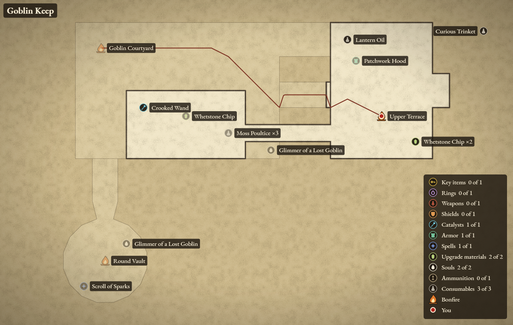

# Layers

An area of the game is three-dimensional: floors above floors, bridges over courtyards,
cellars under halls. A map is flat. Layers are how one becomes the other: the walkable
polygons are sorted into groups so that **no group lies over itself**, and each group is one
layer of the map.

The tracker draws all layers at once: the one the player stands on in full, the ones below
faded, the ones above as a translucent wash with a faint shadow.

*A made-up demo area. The terrace, the bridge and the gallery are one layer; the courtyard
under the gallery is another.*

## What makes a good layering

Two things pull against each other.

1. **A layer must not overlap itself.** If two polygons are one above the other with more
   than a person's height between them (1.8 m by default), they cannot be on the same layer.
2. **A floor should stay on one layer.** Walking across a room must not flip the map to
   another layer because of something that happens to be underneath.

The first builder only did the first: every polygon went on the lowest layer with room for it.
That is valid, but a single storey would change layer wherever a cellar began below it, even
across a doorstep. In play, the highlighted floor flickered. The current method does both.

## The method: connected floors

`FloorLayering` in `src/MapBuilder/Pipeline` works out what is connected first and assigns
layers afterwards, a whole floor at a time.

1. **Links.** Two polygons are linked when their outlines touch seen from above (within
   0.3 m, or one reaching into the other) and the step in height there is small. Going by
   outlines, not shared corners, also joins navigation mesh pieces that were authored
   separately and share no corners.

2. **Level patches.** Polygons that are nearly level (no steeper than 15°) and linked by a
   step of at most 0.6 m form one patch: a floor, a landing, a bridge deck. A patch is never
   cut apart later. Steeper polygons, which are stairs and ramps, stay single.

3. **Regions.** Starting from the lowest unclaimed piece and always taking the lowest
   reachable piece next, pieces are added to a region for as long as the region does not come
   to lie over itself. When it would, the region ends there. Because patches are whole, the
   cut falls on the stairs between two floors and not in the middle of one.

4. **Layers.** Regions that overlap each other can never share a layer. Among the layers
   still open to it, a region goes where the regions it touches already are, so that as few
   small steps as possible lead from one layer to another.

5. **Refinement.** Each single piece (a whole patch, or one stair polygon) may still move to
   the layer most of its neighbours are on, if nothing on that layer lies over or under it.
   Finally the layers are numbered from the bottom up by mean height.

The first rule still holds at the end, and the build checks it: no layer overlaps itself.

## How it is measured

A **seam** is a pair of linked polygons with only a small step between them that ended up on
different layers: a place where the map would change layer under the player's feet for no
visible reason. The builder counts seams for every map and prints the count in its report.

On the area this was developed against, the old method left 4,291 seams and the current one
525. The ones that remain are on stairs and ramps, where a change of layer is expected.

## The numbers you can change

In a development `config.json`:

| Setting | Default | Meaning |
| --- | --- | --- |
| `layerMode` | `floors` | `floors` is the method above. `stack` is the first method, kept for comparison. |
| `layerSplitHeight` | 1.8 | Surfaces stacked further apart than this (metres) can never share a layer. |
| `layerJoinStep` | 0.6 | Largest step (metres) across which two level areas still count as one floor. |
| `layerFlatSlopeDegrees` | 15 | Up to this slope a polygon is floor; steeper is stairs or ramp. |

## Which layer is the player on?

At run time `PolygonLocator` finds the polygon under the player: the nearest one below the
feet, or just above them, within 3 m; failing that, the nearest polygon sideways. That
polygon's layer is the player's layer. Jumping, falling and rolling off an edge keep the last
layer until the feet are over a polygon again.

## Stairs on the map

The same slope test marks stairs and ramps for drawing. The parchment theme draws step lines
across every polygon steeper than 15°: lines of equal height, a fixed distance apart along
the slope. They show which way is up without any knowledge of the real stairs.
