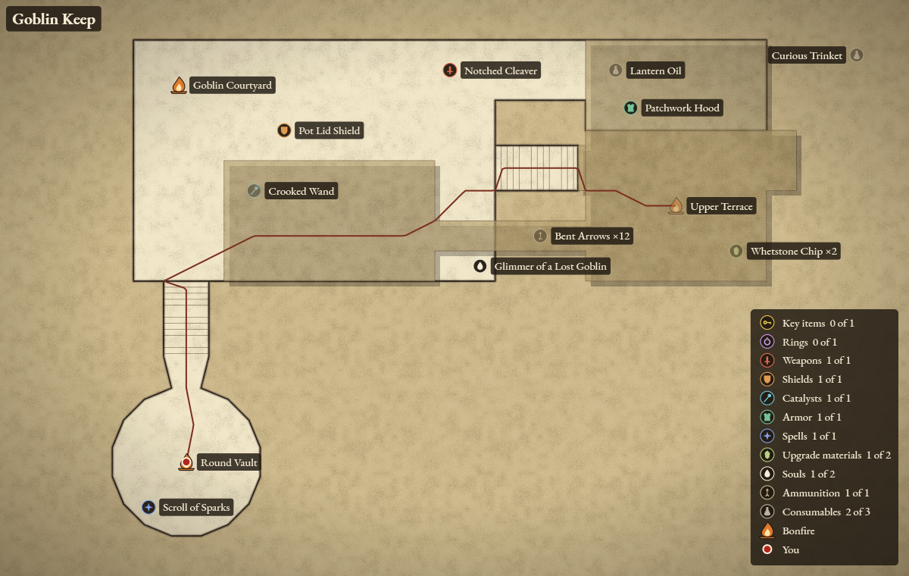
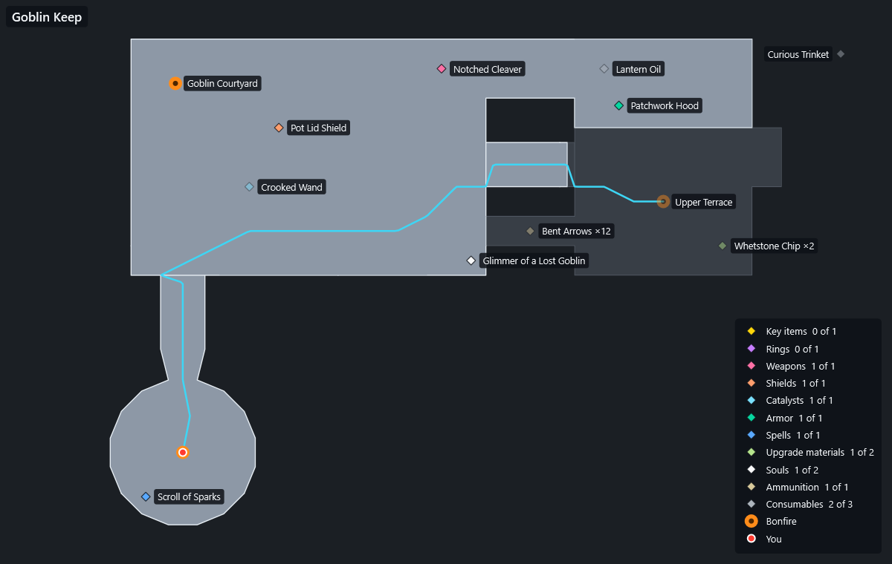

# How the map is drawn, and themes

## What you are looking at

The map is a **stylized floor plan**. It is drawn from the game's navigation mesh, the set of
polygons that say where a character can walk, and from nothing else. There are no walls,
buildings, doors or landmarks in that data, so none are drawn. A hall is the outline of its
floor; a bridge is a ribbon; a cliff edge is simply where the floor stops.

| | |
| --- | --- |
|  |  |
| *parchment* | *plain* |

*A made-up demo area, the same view in both built-in themes.*

Everything is drawn by one class, `MapRenderer`, for the minimap, the full map, the debug
window and exported pictures alike. In order:

1. **Layers below** the shown one, as a pale wash, each step down a little fainter.
2. **The shown layer**: a wash, step lines across stairs and ramps, then an ink outline along
   its outer edge with a soft edge under it.
3. **A faint shadow** of the layers above, offset down and to the right.
4. **Layers above**, as a translucent wash.
5. Paper grain and a vignette (full map and pictures only).
6. The trail of where you have been.
7. Markers: bonfires and items, drawn at a fixed size whatever the zoom.
8. You.
9. Name labels, nearest first, skipping any that would cover another.
10. Legend, title, banner and messages.

The paper grain is generated from a fixed seed, so every run and every machine draws the same
picture. The icons are original vector shapes made for this project; the lettering is EB
Garamond. Nothing is taken from the game.

## Choosing a theme

Settings, under "Look". Two are built in:

- **parchment**: ink on aged paper. Category icons on dark discs, step lines on stairs,
  shadows under upper layers, a round minimap, serif lettering.
- **plain**: flat colours and diamond markers on a dark panel. The look of the development
  versions.

## Editing a theme

Themes are JSON files in the `themes` folder of the data folder ("Open data folder" in the
app). The built-in ones are written there the first time, so there is something to edit. A
file with a new name is a new theme and appears in the settings list. If a file is broken,
the built-in theme of that name is used; delete a file to get the built-in one back.

Colours are written `#RRGGBB` or `#AARRGGBB` (the first pair is opacity). A colour that cannot
be read is drawn in magenta, so the mistake is easy to find.

| Field | What it changes |
| --- | --- |
| `background` | Background of the debug window |
| `panel` | Background of the minimap, and of the full map when `paper` is empty |
| `paper` | Background of the full map and of exported pictures |
| `panelBorder`, `panelBorderWidth` | The thin border of a panel |
| `roundMinimap` | Minimap as a disc instead of a rounded square |
| `floor` | Wash of the shown layer |
| `floorOther` | Wash of the layers below |
| `floorAbove` | Wash of the layers above (empty: same as below) |
| `floorNeutral` | Wash of every layer while the player's layer is unknown |
| `outline`, `outlineWidth` | Ink outline of the shown layer, in screen pixels |
| `outlineOther`, `outlineOtherWidth` | Outline of the other layers |
| `lowerLayerFade` | Extra fade per layer further down (1 = none) |
| `upperLayerShadow`, `shadowOffsetMeters`, `shadow` | Strength, offset and colour of the shadow of upper layers (0 = none) |
| `hatch`, `hatchWidth`, `hatchSpacingMeters` | Step lines on stairs and ramps (empty colour = none) |
| `steepDegrees` | From which slope a polygon counts as stairs |
| `grain`, `vignette` | Strength of the paper texture and of the darkening towards the edges (0 = none) |
| `bonfire`, `bonfireCore`, `bonfireIconSize` | The bonfire marker |
| `categoryIcons` | An icon per category (true) or a diamond for everything (false) |
| `iconPlate` | Colour of the dark disc under each item icon (empty = none) |
| `itemIconSize` | Half the size of an item marker, in screen pixels |
| `markerOutline`, `markerOutlineWidth` | Outline of markers drawn without a plate |
| `categoryColors` | One colour per category |
| `otherLayerMarkerOpacity`, `collectedMarkerOpacity` | How faint markers on other layers, and collected ones, are |
| `player`, `playerRing`, `playerSize` | Your dot |
| `trail`, `trailWidth` | Your trail |
| `labelFont`, `titleFont` | `bundled` for EB Garamond, or the name of a font installed on your computer |
| `labelSize`, `titleSize`, `legendSize` | Lettering sizes |
| `text`, `textMuted`, `labelBackground`, `banner` | Lettering colours and the plates behind labels and messages |

## Trying a theme without the game

```text
LootGoblinsMap.exe --data C:\Temp\lgm-demo --make-demo
LootGoblinsMap.exe --data C:\Temp\lgm-demo --replay C:\Temp\lgm-demo\demo_walk.txt --png C:\Temp\lgm-demo\look.png --view full --theme parchment
```

`--view` is `minimap` or `full` (the overlay over a stand-in backdrop), or `fit` or `follow`
(the map alone). Add `--clean` to leave the debug readout off the picture. Theme files for
that data folder are in `C:\Temp\lgm-demo\themes`.
